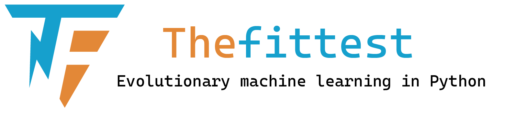

.. image:: https://img.shields.io/pypi/v/thefittest?label=PyPI%20-%20Package%20version
    :target: https://pypi.org/project/thefittest/
    :alt: PyPI - Package version
.. image:: https://static.pepy.tech/badge/thefittest
    :target: https://pepy.tech/project/thefittest
    :alt: Downloads
.. image:: https://komarev.com/ghpvc/?username=thefittest
    :alt: Profile views
.. image:: https://codecov.io/github/sherstpasha/thefittest/coverage.svg?branch=master
    :alt: codecov.io
.. image:: https://app.codacy.com/project/badge/Grade/4c47b6de61c4422180529bbc360262c4
    :target: https://app.codacy.com/gh/sherstpasha/thefittest/dashboard?utm_source=gh&utm_medium=referral&utm_content=&utm_campaign=Badge_grade
    :alt: Codacy Badge
.. image:: https://img.shields.io/badge/code%20style-black-000000.svg
    :target: https://github.com/psf/black
    :alt: Code style: black
.. image:: https://readthedocs.com/projects/sherstpasha-pavel/badge/?version=latest&token=71adf5d63b55f0def96b09e1ce4c60f8d57cbdaed7db777117f34e4718d5a1ea
    :target: https://sherstpasha-pavel.readthedocs-hosted.com/ru/latest/?badge=latest
    :alt: Documentation Status
    

``thefittest`` is an open-source library designed for the efficient application of classical evolutionary algorithms and their effective modifications in optimization and machine learning. Our project aims to provide performance, accessibility, and ease of use, opening up the world of advanced evolutionary methods to you.

Installation
------------

**Basic installation** (for evolutionary algorithms and symbolic regression):

.. code-block:: bash

    pip install thefittest

This installation includes all evolutionary optimizers (GA, DE, SHADE, etc.) and symbolic regression with GP.

**Neural networks on CPU or GPU**:

.. code-block:: bash

    python -m pip install "thefittest[torch]"

Neural estimators default to ``device="cpu"``. For CUDA, install the appropriate
PyTorch build using https://pytorch.org/get-started/locally/ and select
``device="cuda"``. CUDA is optional.

Usage Example
-------------

The following example demonstrates how to use ``thefittest`` library with the SHADE optimizer to minimize a custom objective function. This quick start example showcases the main components needed to set up and run an optimization.

.. code-block:: python

    from thefittest.optimizers import SHADE

    # Define the objective function to minimize
    def custom_problem(x):
        return (5 - x[:, 0])**2 + (12 - x[:, 1])**2

    # Initialize the SHADE optimizer with custom parameters
    optimizer = SHADE(
        fitness_function=custom_problem,
        iters=25,
        pop_size=10,
        left_border=-100,
        right_border=100,
        num_variables=2,
        show_progress_each=10,
        minimization=True,
    )

    # Run the optimization
    optimizer.fit()

    # Retrieve and print the best solution found
    fittest = optimizer.get_fittest()
    print('The fittest individ:', fittest['phenotype'])
    print('with fitness', fittest['fitness'])

Machine Learning Example
------------------------

This example demonstrates how to train a machine learning model on the Iris dataset using ``thefittest`` library's ``MLPEAClassifier`` with the SHAGA evolutionary optimizer.

.. code-block:: python

    from thefittest.optimizers import SHAGA
    from thefittest.benchmarks import IrisDataset
    from thefittest.classifiers import MLPEAClassifier

    from sklearn.model_selection import train_test_split
    from sklearn.preprocessing import minmax_scale
    from sklearn.metrics import confusion_matrix, f1_score

    # Load the Iris dataset
    data = IrisDataset()
    X = data.get_X()
    y = data.get_y()

    # Scale features to the [0, 1] range
    X_scaled = minmax_scale(X)

    # Split the data into training and test sets
    X_train, X_test, y_train, y_test = train_test_split(X_scaled, y, test_size=0.1)

    # Initialize the MLPEAClassifier with SHAGA as the optimizer
    model = MLPEAClassifier(
        n_iter=500,
        pop_size=500,
        hidden_layers=[5, 5],
        weights_optimizer=SHAGA,
        weights_optimizer_args={"show_progress_each": 10}
    )

    # Train the model
    model.fit(X_train, y_train)
    
    # Make predictions on the test set
    predict = model.predict(X_test)

    # Evaluate the model
    print("confusion_matrix: \n", confusion_matrix(y_test, predict))
    print("f1_score: \n", f1_score(y_test, predict, average="macro"))

Documentation
-------------

For detailed installation instructions, usage examples, API reference, and additional information, see the `official documentation <https://sherstpasha.github.io/thefittest/>`_.

Awards and Presentations
-------------------------

- **1st place**, Samsung Innovation Campus (IT Academy), *Artificial Intelligence* track, October 2024. `Read more <https://news.samsung.com/ru/объявлены-итоги-ежегодного-межвузов>`_;  
- **Best PhD Student Paper** at the 12th International Workshop on Mathematical Models and their Applications (IWMMA'2023) for the paper "Thefittest: Evolutionary Machine Learning in Python" by Pavel Sherstnev. `Watch presentation <https://youtu.be/R46b1tt5qUo?si=ZxGIcX2-sWJEWCbt&t=4550>`_;  
- **Tutorial** Presenter at the 13th International Workshop on Mathematical Models and their Applications (IWMMA'2024) with the tutorial titled "Thefittest Library: Evolutionary Algorithms and Automation of Machine Learning Models Design in Python". `Watch tutorial <https://www.youtube.com/watch?v=PtDahwMstuw>`_;  
- **2nd place**, Youth IT Project Competition "Soft-Parade 2025". `More details <https://www.soft-parade.ru/archive>`_
- **2nd place**, GitVerse, Cloud.ru and Habr Open Source Grant Program "Code Without Borders" 2025. `More details <https://gitverse.ru/blog/articles/open-source/1172-pozdravlyaem-pobeditelej-grantovoj-programmy-kod-bez-granic>`_
- **International University Award "Gravitation" 2025** in the category *"Algorithms and Software Solutions in AI and Big Data"*, awarded by the Presidential Academy, Tomsk State University, and the Association *"University Consortium of Big Data Researchers"*. `More details <https://gravitation.ai/2025>`_
